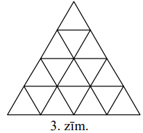
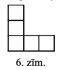
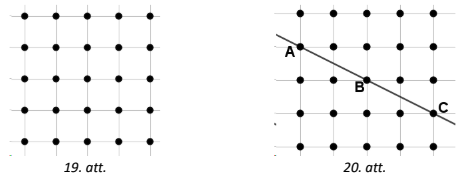

# 7.3.temats: Dirihlē princips. Kad (trušu) sadursmes ir neizbēgamas

## 1.daļa. Vienkāršais un vispārinātais princips; būru izvēle

## LV.NOL.2018.6.2

Koru finālskatē piedalījās desmit zēnu kori, kopā $291$ dalībnieks. Katrs
dalībnieks dzied tieši vienā korī.

**a)** Vai noteikti ir tāds koris, kurā ir tieši $20$ dalībnieki?  
**b)** Vai var gadīties, ka ir tāds koris, kurā ir tieši $32$ dalībnieki?  
**c)** Vai var apgalvot, ka ir tieši viens tāds koris, kurā ir vismaz $30$
dalībnieki?  
**d)** Vai noteikti ir tāds koris, kurā ir vismaz $30$ dalībnieki?

* *Saprašana*: "Noteikti ir" prasa pierādījumu, bet "var gadīties" vai
  "nē, ne noteikti" — tikai vienu piemēru. Kurš jautājums ir kurā veidā?

## LV.NOL.2018.7.2

Maisiņā bija $10$ sarkanas, $10$ dzeltenas un $10$ zaļas lentes. Tautas deju
kolektīva astoņas meitenes katra izvēlējās vienu lenti no šī maisiņa.

**a)** Vai var apgalvot, ka tieši četras meitenes izvēlējās vienādas krāsas
lentes?  
**b)** Vai noteikti ir vismaz trīs meitenes, kas izvēlējās vienādas krāsas
lentes?  
**c)** Kāds mazākais skaits lenšu būtu jāizņem no maisiņa, lai varētu
apgalvot, ka vismaz četras no tām ir vienā krāsā?

* *Risināšana*: c) daļā ir divi apgalvojumi — "ar $N$ pietiek" (Dirihlē) un
  "ar $N-1$ var nepietikt" (sliktākais gadījums: cik lenšu var paņemt, lai
  katrā krāsā būtu ne vairāk kā $3$?).

## LV.NOL.2018.8.2

Maisiņā ir sarkanas, dzeltenas un zaļas lentes. Katra no meiteņu kora $29$
dalībniecēm izvēlējās tieši trīs no šīm lentēm (ne obligāti dažādās krāsās).

**a)** Vai noteikti ir tāds lenšu krāsu komplekts, ko izvēlējās tieši divas
meitenes?  
**b)** Vai noteikti ir tāds lenšu krāsu komplekts, ko izvēlējās vismaz trīs
meitenes?  
**c)** Kāds mazākais skaits no dalībniecēm jāizvēlas, lai starp tām noteikti
būtu trīs meitenes, kas izvēlējās vienu un to pašu lenšu krāsu komplektu?

* *Izpēte*: Būri ir komplekti. Uzraksti tabulu: cik sarkanu, dzeltenu, zaļu
  lenšu ir komplektā? Cik pavisam ir komplektu?

## LV.AMO.2024.6.2

Kastē ir $14$ violetas, $18$ brūnas, $4$ oranžas un $19$ dzeltenas bumbiņas.
Anna no kastes izvilka $9$ bumbiņas.

**(A)** Vai var apgalvot, ka tieši piecas no izvilktajām bumbiņām ir
dzeltenas?  
**(B)** Vai Anna noteikti izvilka vismaz trīs vienādas krāsas bumbiņas?  
**(C)** Kāds mazākais skaits bumbiņu Annai vēl ir jāizvelk no kastes, lai
varētu apgalvot, ka kopumā Annai vismaz sešas no bumbiņām ir vienā krāsā?

* *Izpēte*: (C) daļā viena krāsa ir "nepilnvērtīgs būris" — oranžo bumbiņu
  ir tikai $4$, un tās nekad nevar dot sešas vienā krāsā. Kā sliktākais
  gadījums to izmanto?

## LV.NOL.2013.9.5

Profesora Cipariņa olimpiādē bija $3$ uzdevumi. Tajā piedalījās $100$
skolēni. Pierādīt, ka atradīsies vismaz $13$ skolēni, kas izrēķināja vienus
un tos pašus uzdevumus (vai arī neizrēķināja nevienu uzdevumu).

Katrs skolēns katru uzdevumu vai nu izrēķināja vai neizrēķināja, daļēji
risinājumi netika iesniegti.

* *Pārformulēšana*: Kas ir būri? Katram uzdevumam ir divas iespējas
  ("atrisināts"/"nav"). Cik ir dažādu atrisināto uzdevumu komplektu
  (ieskaitot tukšo)?

## LV.AMO.2023.7.1

Vai rindā kaut kādā secībā var uzrakstīt naturālus skaitļus **(A)** no $1$
līdz $23$; **(B)** no $1$ līdz $2023$ tā, lai blakus skaitļiem nebūtu
vienādu ciparu?

* *Pārformulēšana*: (B) daļā sadali rindu blakus esošu skaitļu pāros
  ($1.$ ar $2.$, $3.$ ar $4.$, ...) — tie ir būri. Kādi skaitļi ir "truši"?
  Cik skaitļu no $1$ līdz $2023$ satur ciparu $1$?

## LV.NOL.2017.9.5

**(A)** Pierādīt, ka starp $1010$ dažādiem naturāliem skaitļiem, no kuriem
neviens nepārsniedz $2017$, vienmēr iespējams izvēlēties trīs skaitļus tā,
ka divu izvēlēto skaitļu summa ir vienāda ar trešo skaitli!

**(B)** Vai šāda īpašība ir spēkā arī $1009$ dažādiem naturāliem skaitļiem,
kas nepārsniedz $2017$?

* *Izpēte*: Sāc ar ekstremālo elementu — lielāko izvēlēto skaitli $x$.
  Sadali visus skaitļus, kas mazāki par $x$, pāros ar summu $x$. Cik ir šādu
  pāru? (B) daļā meklē piemēru, kur summa "vienmēr ir citas paritātes".

## LV.NOL.2006.8.3

Vai var izrakstīt rindā visus naturālos skaitļus no $1$ līdz $2006$
ieskaitot katru vienu reizi tā, lai katru $3$ pēc kārtas uzrakstīto skaitļu
summa dalītos ar $4$?

* *Izpēte*: Salīdzini summas $a+b+c$ un $b+c+d$. Ko var secināt par $a$ un
  $d$ atlikumiem, dalot ar $4$? Cik vietās rindā tad jābūt vienam un tam
  pašam atlikumam, un cik skaitļu ar katru atlikumu vispār ir?

# 2.daļa. Ekstremālais elements, vidējā vērtība, rūtiņu lapa

## LV.NOL.2012.7.5

Vienādmalu trijstūris ar malas garumu $4$ sadalīts $16$ vienādos trijstūros
(skat. zīm.). Katrā mazajā trijstūrī ir ierakstīts viens skaitlis, pavisam
ierakstīti septiņi trijnieki un deviņi piecinieki.

Pierādīt, ka var izvēlēties četrus trijstūrus, kas veido vienādmalu
trijstūri ar malas garumu $2$ un kuros ierakstīto skaitļu summa ir vismaz
$18$.

{: width="150"}

* *Pārformulēšana*: Kāda ir "lielā" trijstūra ar summu $18$ sastāvs? (Trīs
  piecinieki un viens trijnieks.) Sadali lielo trijstūri četros
  nepārklājošos trijstūros ar malu $2$.

## LV.NOL.2024.8.4

Konditorejā nopērkamas $16$ tortes, to cena ir attiecīgi $30; 31; 32; \ldots;
45$ eiro (katra torte ir tieši vienā eksemplārā). Konditorejā viens pēc otra
iegriezās $5$ gardēži, katrs no tiem nopirka sev dažas tortes, turklāt katrs
iztērēja ne vairāk kā $125$ eiro. Pierādīt, ka pēc gardēžu apmeklējuma
vismaz viena torte vēl palika nenopirkta!

* *Izpēte*: Cik maksā četras **lētākās** tortes? Ko tas nozīmē par tortu
  skaitu, ko var nopirkt viens gardēdis?

## LV.AMO.2014.7.5

Kādu mazāko skaitu rūtiņu jāizgriež no kvadrāta $6 \times 6$, lai no
atlikušās daļas nevarētu izgriezt zīmējumā parādīto figūru? (Figūru malām
jāiet pa rūtiņu līnijām.)

{: width="100"}

* *Izpēte*: Cik rūtiņas jāizgriež no kvadrāta $3 \times 3$, lai tajā vairs
  neietilptu figūra? Cik šādu kvadrātu var izvietot $6 \times 6$ kvadrātā?
  Neaizmirsti arī piemēru!

## LV.NOL.2024.8.3

Uz rūtiņu lapas rūtiņu krustpunktos atzīmēti $25$ punkti (skat. 19. att.).
Kāds mazākais skaits punktu jānodzēš, lai nekādi trīs no atlikušajiem
punktiem neatrastos uz vienas taisnes?

*Piezīme.* Ievēro, ka uz vienas taisnes atrodas ne tikai punkti, kas atrodas
vienā rindā, kolonnā vai diagonālē, bet arī, piemēram, punkti $A, B, C$
(skat. 20. att.)!

{: width="300"}

* *Pārformulēšana*: Būri ir $5$ rindas. Cik punktu drīkst palikt vienā
  rindā? Novērtējums ir vienkāršs — grūtākā daļa ir piemērs, kurā jāpārbauda
  **visas** taisnes, ne tikai rindas, kolonnas un diagonāles.

## LV.NOL.2014.7.5

Pilsētas ielu tīkls veido kvadrātveida režģi, kas sastāv no $8 \times 8$
vienādām kvadrātiskām rūtiņām. Katrā no $81$ rūtiņu stūriem ir autobusu
pietura; citu pieturu nav. Kādu vismazāko skaitu autobusa maršrutu jāievieš,
lai no katras pieturas varētu aizbraukt uz katru citu, izdarot ne vairāk kā
vienu pārsēšanos? Pa katru maršrutu autobuss kursē abos virzienos; katrs
maršruts drīkst saturēt augstākais vienu pagriezienu.

* *Pārformulēšana*: Katrs maršruts iet pa augstākais vienu horizontālu un
  vienu vertikālu ielu. Cik pavisam ir horizontālo un vertikālo ielu? Kas
  notiek ar pieturu, kurā krustojas divas ielas bez neviena maršruta?

## LV.NOL.2017.7.5

Kāds ir mazākais rūtiņu skaits, kas jāiekrāso $4 \times 4$ rūtiņu kvadrātā,
lai neatkarīgi no tā, kuras divas rūtiņu rindas un divas rūtiņu kolonnas
tiktu izmestas, vismaz viena iekrāsotā rūtiņa paliktu neizmesta?

* *Izpēte*: Pierādi, ka $6$ iekrāsotas rūtiņas vienmēr var izmest. Kurā
  rindā ir visvairāk iekrāsoto rūtiņu? (Gadījumi: kādā rindā ir vismaz $3$;
  visās rindās ne vairāk kā $2$ — tad Dirihlē princips lieto divreiz.)

## LV.AMO.2025.8.4

Ilmārs grib uznest augšā uz dzīvokli $150$ kg ķirbju. Zināms, ka katrs
ķirbis sver ne vairāk kā $10$ kg. Vienā reizē viņš var uznest patvaļīgu
daudzumu ķirbju, kas kopā sver ne vairāk kā $30$ kg. Kāds ir mazākais reižu
skaits, ar kuru Ilmārs noteikti var uznest visus ķirbjus (neatkarīgi no to
svara)? Griezt gabalos ķirbjus nedrīkst!

* *Izpēte*: Novērtējumam "var nepietikt" meklē sliktu gadījumu ar daudziem
  vienādiem ķirbjiem, kur četri ķirbji jau sver vairāk par $30$ kg. Lai
  pamatotu "pietiek", izdomā, cik daudz Ilmārs **noteikti** var paņemt katrā
  reizē (ņem ķirbjus, kamēr nesasniedz $20$ kg).

## LV.NOL.2010.8.5

Katras divas no $6$ lampām savienotas ar baltu vai sarkanu vītni. Pierādīt:
var atrast tādas $3$ lampas, kuras visas savā starpā savienotas ar vienas
krāsas vītnēm.

* *Izpēte*: Aplūko vienu lampu $A$. No tās iziet $5$ vītnes divās krāsās —
  ko par tām saka Dirihlē princips? Tālāk aplūko vītnes starp šo vītņu otrajiem
  galiem.
